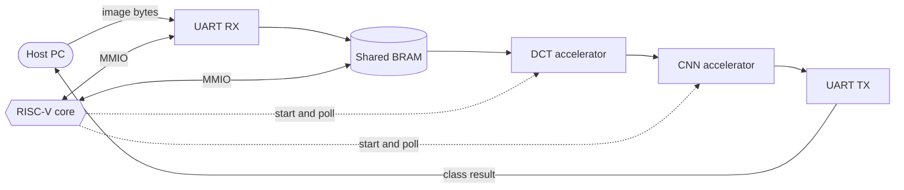
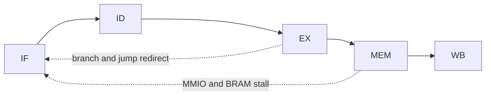
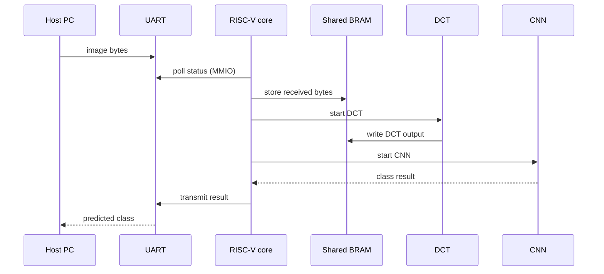

# RISC-V SoC for Edge Image Classification

A 5-stage pipelined RISC-V core with memory-mapped peripherals and hardware DCT and CNN accelerators, written in Verilog. An image is received over UART, processed in hardware, and the classification result is sent back over UART.


## Contents

- [Overview](#overview)
- [Architecture](#architecture)
- [Dataflow](#dataflow)
- [Repository layout](#repository-layout)
- [Running the simulation](#running-the-simulation)
- [Results](#results)
- [Debugging notes](#debugging-notes)
- [Roadmap](#roadmap)

## Overview

| Item | Detail |
|:--|:--|
| Core | 5-stage pipeline: IF, ID, EX, MEM, WB |
| Peripherals | UART (baud period 8680 ns), shared BRAM, MMIO |
| Accelerators | DCT engine, CNN engine using LeNet-5 weights |
| Firmware | Polls UART over MMIO, stores the image in BRAM, starts the accelerators, returns the result |
| Verification | Vivado XSim on Windows, Icarus Verilog on Linux |

## Architecture



Core pipeline:



Hazard handling covers operand forwarding, load-use stalls, branch and jump flushes, and stall freezes for MMIO and shared-BRAM accesses.

## Dataflow



## Repository layout

```text
mjp_final/
├── rtl/
│   ├── riscv_core_pkg.v    pipeline registers, memories, data_memory
│   ├── <core>.v            5-stage RISC-V core
│   ├── riscv_soc.v         top-level integration
│   ├── accelerators.v      DCT and CNN accelerators
│   └── peripherals.v       UART
├── tb/
│   └── tb_riscv_soc.v      system testbench
├── sw/
│   ├── firmware.hex        loaded with $readmemh
│   └── lenet5_weights.hex  CNN weights
└── README.md
```

## Running the simulation

Icarus Verilog:

```bash
iverilog -o soc_sim rtl/*.v tb/tb_riscv_soc.v
vvp soc_sim
```

Vivado XSim:

1. Create a project and add the files in `rtl/` as design sources.
2. Add `tb/tb_riscv_soc.v` as the simulation source.
3. Keep `firmware.hex` and `lenet5_weights.hex` reachable by `$readmemh`.
4. Run behavioral simulation.

## Results

Not yet measured. This table will be filled in from synthesis and simulation runs.

| Metric | Value |
|:--|:--|
| Target board and part | to be added |
| Vivado version | to be added |
| LUT / FF / DSP / BRAM | to be added |
| Maximum clock frequency | to be added |
| Cycles per inference | to be added |
| LeNet-5 accuracy | to be added |

## Debugging notes

Bugs found during bring-up, each isolated from waveforms and cross-checked between XSim and Icarus.

<details>
<summary>JAL and JALR target</summary>

The jump target was selected using an ALU control code shared by JAL and JALR, so JAL used a register value instead of `ex_pc + imm`. Fix: decode `id_is_jalr` from the opcode in ID, pipeline it as `ex_is_jalr`, and use it in the `branch_target` mux.
</details>

<details>
<summary>MMIO and shared-BRAM stall race</summary>

`mmio_stall` asserted one cycle late, so EX/MEM advanced and overwrote results before the freeze took effect. Fix: a combinational `mmio_start` wire ORed into the stall, plus a `mmio_just_done` guard to prevent a retrigger deadlock on release. The shared-BRAM path uses the same pattern with `shared_stall` and `shared_just_done`.
</details>

<details>
<summary>Instruction fetch and PC misalignment</summary>

A synchronous instruction-memory read made `instr_o` lag `pc` by one cycle, which dropped instructions under stall. Fix: combinational read using distributed RAM.
</details>

Takeaways: a stall that depends on a registered signal leaves a one-cycle window where stages advance incorrectly, jump type must be decoded from the opcode, and waveforms should be checked before changing logic.

## Roadmap

- [x] 5-stage core, UART, shared BRAM, MMIO
- [x] Fixes for JAL/JALR, stall races and fetch alignment
- [ ] End-to-end UART, DCT, CNN, UART verification
- [ ] FPGA synthesis and implementation
- [ ] Timing and resource report
- [ ] Accuracy measurement

## Author

A S Prajwal Bhat. [GitHub](https://github.com/AS-Prajwal-Bhat)
