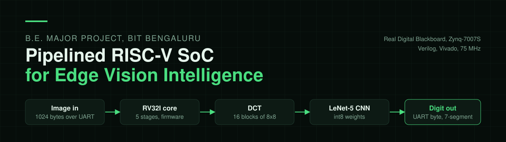
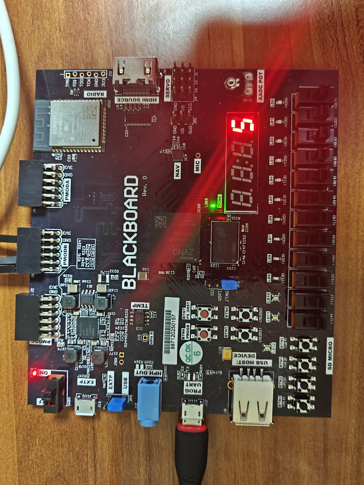
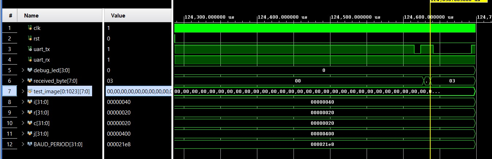
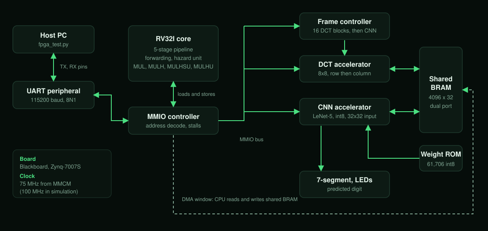

<p align="center"></p>

<p align="center">
  
  
  
  
</p>

# Pipelined RISC-V SoC for Edge Vision Intelligence

A 5-stage RV32I processor, an 8x8 DCT accelerator and a LeNet-5 CNN accelerator on one chip. A host sends a 32x32 grayscale image over UART. The SoC runs the DCT on 16 blocks, feeds the coefficients to the CNN, and returns the predicted digit as a UART byte and on a 7-segment display.

B.E. major project, Department of ECE, BIT Bengaluru.

## Result on hardware

The design runs on a Real Digital Blackboard (Zynq-7007S). The test image `mem/digit5_32x32.hex` is sent from a PC with `sw/fpga_test.py`. The SoC answers with class 5, and the 7-segment display shows 5.

<p align="center"> </p>

| Check | Result |
|---|---|
| Simulation (Vivado xsim, digit 3 image) | `received_byte = 03` |
| FPGA (digit 5 image, COM8) | class 5, shown on 7-segment |
| Clock | 75 MHz from an MMCM, 100 MHz board clock in |

Resource utilisation, timing slack, power and inference latency are not reported here yet. They will be added from the Vivado reports.

## How it works

1. The host streams 1024 bytes (one 32x32 image) over UART at 115200 baud.
2. Firmware on the RV32I core copies the bytes into the shared BRAM and writes one trigger to the frame controller.
3. The frame controller runs the 8x8 DCT over a 4x4 grid of blocks. Each block is a row pass then a column pass, with a Q8.8 cosine table. Coefficients are stored as 16-bit values, two per word.
4. The 32x32 coefficient frame goes straight to the CNN: conv1 (6 @ 5x5), average pool, conv2 (16 @ 5x5), average pool, then FC 400-120-84-10 and an argmax.
5. The class is written to the UART and latched on the 7-segment display.

Weights are int8, stored sign-extended in a 65,536-deep ROM (61,706 words used) loaded from `mem/lenet5_weights.hex`. Each layer has its own requantisation constant, with a pipelined requantiser (`RQ_SHIFT = 24`).

## Architecture

<p align="center"></p>

| Block | File | Notes |
|---|---|---|
| RV32I core | `rtl/riscv_core.v`, `rtl/riscv_core_pkg.v` | 5 stages, forwarding, hazard detection, MUL/MULH/MULHSU/MULHU/DIV, MMIO stall logic |
| SoC top | `rtl/riscv_soc.v` | MMCM, MMIO controller, DMA window, frame controller, instruction and weight memories |
| Accelerators | `rtl/accelerators.v` | `dct_accelerator`, `cnn_accelerator`, `bram_arbiter`, `frame_controller`, `sdp_ram` |
| Peripherals | `rtl/peripherals.v` | UART, MMIO controller, GPIO, debug LEDs |
| Display | `rtl/seg7_display.v` | latches the predicted digit, rightmost digit only |

The shared BRAM is 4096 x 32, true dual port. The CPU and DMA side has priority over the accelerators.

## Memory map

| Region | Address | Notes |
|---|---|---|
| Private CPU memory | `0x0000_0000` to `0x3FFF_FFFF` | CPU data memory, separate from instruction memory |
| DCT registers | `0x4000_0000` | MMIO |
| CNN registers | `0x4000_0100` | MMIO |
| UART | `0x4000_0200` | MMIO |
| GPIO | `0x4000_0300` | MMIO |
| Shared BRAM | `0x8000_0000` and up | image and accelerator buffer, CPU/DMA port |

Frame controller offsets are in `rtl/accelerators.v` and `rtl/riscv_soc.v`.

<details>
<summary>Peripheral registers</summary>

**CNN (`0x4000_0100`)**

| Offset | Register | Description |
|---|---|---|
| 0x00 | CTRL | bit 0 start, bit 1 done |
| 0x04 | STATUS | `{done, busy}` |
| 0x08 | INPUT_ADDR | input buffer address |
| 0x0C | OUTPUT_ADDR | result buffer address |
| 0x10 | CLASS | predicted class (argmax) |
| 0x14 | CONF | winning score |

**DCT (`0x4000_0000`)**

| Offset | Register | Description |
|---|---|---|
| 0x00 | CTRL / STATUS | write bit 0 to start, read `{done, busy}` |
| 0x04 | BUSY | busy flag |
| 0x08 | INPUT_ADDR | 8x8 block source |
| 0x0C | OUTPUT_ADDR | coefficient destination |

**UART (`0x4000_0200`)**

| Offset | Register | Description |
|---|---|---|
| 0x0 | DATA | write: transmit byte, read: receive byte |
| 0x4 | STATUS | `{rx_valid, tx_busy}` |

</details>

## Pipeline hazards

- Forwarding from MEM and WB into EX
- Load-use stall, extended to multi-cycle MMIO reads
- Multiply and divide stall while the unit is busy
- Branch and jump flush of IF/ID
- A MEM-stage stall freezes all five stages

## Debugging notes

Bugs found during bring-up, each isolated from waveforms.

<details>
<summary>JAL and JALR target</summary>

The jump target used an ALU control code shared by JAL and JALR, so JAL used a register value instead of `ex_pc + imm`. Fix: decode `id_is_jalr` from the opcode in ID, pipeline it as `ex_is_jalr`, and use it in the `branch_target` mux.
</details>

<details>
<summary>MMIO and shared-BRAM stall race</summary>

`mmio_stall` asserted one cycle late, so EX/MEM advanced and overwrote results before the freeze took effect. Fix: a combinational `mmio_start` wire ORed into the stall, plus a `mmio_just_done` guard against a retrigger deadlock on release. The shared-BRAM path uses the same pattern with `shared_stall` and `shared_just_done`.
</details>

<details>
<summary>MMIO controller double transaction</summary>

The controller started a second transaction when `mmio_request` was still high in the cycle `mmio_ready` cleared `pending`, so reads returned the previous value. Fix: register `mmio_request` and start only on its rising edge.
</details>

<details>
<summary>Instruction fetch and PC misalignment</summary>

A synchronous instruction-memory read made `instr_o` lag `pc` by one cycle, which dropped instructions under stall. Fix: combinational read using distributed RAM.
</details>

Takeaways: a stall that depends on a registered signal leaves a one-cycle window where stages advance wrongly; decode jump type from the opcode; check the waveform before changing logic.

## Repository layout

```
rtl/          Verilog sources
tb/           tb_riscv_soc.v (UART in, class out)
constraints/  riscv_soc.xdc for the Blackboard
mem/          firmware.hex, lenet5_weights.hex, digit0..9 test images
sw/           fpga_test.py (UART host script)
docs/         banner, block diagram, figures
```

## Run the simulation

1. Create a Vivado project. Add `rtl/*.v` as design sources and `tb/tb_riscv_soc.v` as a simulation source.
2. Add `mem/firmware.hex` and `mem/lenet5_weights.hex` to the project so `$readmemh` finds them.
3. In `tb/tb_riscv_soc.v`, set the image path to a file in `mem/`.
4. Run behavioural simulation. The testbench sends 1024 bytes over UART and prints the received class.

## Run on the board

1. Target `xc7z007sclg400-1`. Add `constraints/riscv_soc.xdc`, synthesise, implement, generate the bitstream and program the PL.
2. Connect a 3.3 V USB-serial adapter to Pmod B: FPGA RX is D19 (JB1) and FPGA TX is D20. Reset is BTN0 (W14).
3. Install pyserial and send an image:

```
pip install pyserial
python sw/fpga_test.py --port COM8 --image mem/digit5_32x32.hex
```

The script prints the raw byte and `PREDICTED DIGIT`. The same digit appears on the 7-segment display.

## References

The design draws on published work on RISC-V SoCs, CNN accelerators, MAC units, DCT hardware and clock gating, including LeNet-5 FPGA implementations and the Loeffler DCT architecture.

## Team

A S Prajwal Bhat and team, B.E. ECE, BIT Bengaluru.

## Contact

[Portfolio](https://as-prajwal-bhat.github.io/AS_Prajwal_Bhat/) · [GitHub](https://github.com/AS-Prajwal-Bhat)
