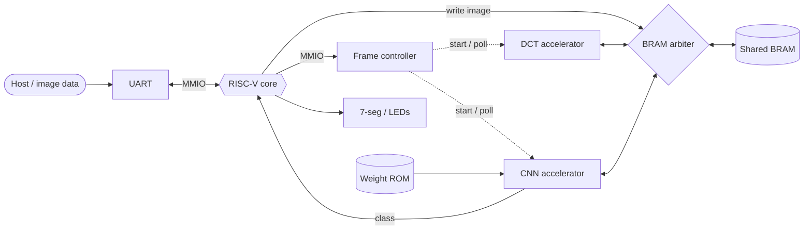
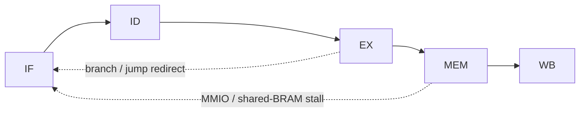

<div align="center">

# RISC-V SoC for Edge Image Classification

**A 5-stage pipelined RISC-V core with memory-mapped peripherals, a frame controller, and hardware DCT and LeNet-5-inspired CNN accelerators, written in Verilog and targeting the Real Digital Blackboard.**

An image is loaded, processed in hardware, and a predicted class is produced.


[Overview](#-overview) •
[Architecture](#-architecture) •
[Memory map](#-memory-map) •
[Accelerators](#-accelerators) •
[Layout](#-repository-layout) •
[Simulation](#-running-the-simulation) •
[Results](#-results) •
[Debug log](#-debugging-notes) •
[Roadmap](#-roadmap)

</div>

---

## ✨ Overview

| | |
|:--|:--|
| **Target** | Real Digital Blackboard Rev D, Xilinx Zynq-7000 XC7Z007S-CLG400 (programmable logic only) |
| **Core** | 5-stage pipeline (IF, ID, EX, MEM, WB) with forwarding, hazard detection and a multiply unit |
| **Peripherals** | UART, GPIO, 7-segment display, MMIO controller |
| **Memories** | CPU instruction and data memories, shared BRAM, separate weight ROM |
| **Accelerators** | DCT engine and LeNet-5-inspired CNN engine, orchestrated by a frame controller |
| **Verification** | Vivado XSim behavioral simulation with a recorded digit-5 sample |

---

## 🏗 Architecture



**Shared BRAM priority:** CPU/DMA port first, then DCT, then CNN.

### Core pipeline



**Hazard handling**

- Operand forwarding from MEM and WB into EX
- Load-use stall, extended to cover multi-cycle MMIO reads
- Multiply/divide stall while the unit is busy
- Branch and jump flush of IF/ID
- A MEM-stage stall freezes all five pipeline stages

---

## 🗺 Memory map

| Region | Address | Notes |
|:--|:--|:--|
| Private CPU memory | `0x0000_0000` – `0x3FFF_FFFF` | CPU data BRAM, separate from the instruction memory |
| DCT registers | `0x4000_0000` | MMIO |
| CNN registers | `0x4000_0100` | MMIO |
| UART | `0x4000_0200` | MMIO |
| GPIO | `0x4000_0300` | MMIO |
| Shared BRAM | `0x8000_0000` + | Image and accelerator buffer, accessed on the CPU/DMA port |

> Frame-controller registers: see `rtl/accelerators.v` and `rtl/riscv_soc.v` for the current offsets. The table above covers the base MMIO decode.

<details>
<summary><b>Peripheral register maps</b></summary>

**CNN** (`0x4000_0100`)

| Offset | Register | Description |
|:--|:--|:--|
| `0x00` | CTRL | bit 0 start, bit 1 done flag |
| `0x04` | STATUS | `{done, busy}` |
| `0x08` | INPUT_ADDR | input buffer address |
| `0x0C` | OUTPUT_ADDR | result buffer address |
| `0x10` | CLASS | predicted class (argmax) |
| `0x14` | CONF | winning score |

**DCT** (`0x4000_0000`)

| Offset | Register | Description |
|:--|:--|:--|
| `0x00` | CTRL / STATUS | write bit 0 to start, read `{done, busy}` |
| `0x04` | BUSY | busy flag |
| `0x08` | INPUT_ADDR | 8×8 block source |
| `0x0C` | OUTPUT_ADDR | coefficient destination |

**UART** (`0x4000_0200`)

| Offset | Register | Description |
|:--|:--|:--|
| `0x0` | DATA | write: transmit byte, read: receive byte |
| `0x4` | STATUS | `{rx_valid, tx_busy}` |

</details>

---

## ⚙️ Accelerators

**DCT engine.** Loads an 8×8 block from shared BRAM, runs a row pass then a column pass on a multiply-accumulate datapath, and writes the coefficients back.

**CNN engine.** LeNet-5-inspired pipeline on a single shared MAC, with weights streamed from a block-RAM ROM initialised from `mem/lenet5_weights.hex`:


---

## 📁 Repository layout

```text
riscv-soc-edge-vision/
├── rtl/
│   ├── riscv_soc.v          top-level integration
│   ├── riscv_core.v         5-stage pipelined core
│   ├── riscv_core_pkg.v     pipeline registers, memories, ALU, hazard/forwarding
│   ├── accelerators.v       DCT, CNN, BRAM arbiter
│   ├── peripherals.v        UART TX/RX, MMIO controller
│   └── seg7_display.v       7-segment display driver
├── tb/
│   └── tb_riscv_soc.v       system testbench
├── mem/
│   ├── firmware.hex         program loaded with $readmemh
│   ├── lenet5_weights.hex   CNN weights
│   └── digit5_32x32.hex     sample digit-5 test image
├── constraints/
│   └── riscv_soc.xdc        Blackboard pin and clock constraints
├── docs/
│   └── digit5_preview.png   preview of the test image
└── .gitignore
```

---

## ▶️ Running the simulation

1. Create a Vivado project for part `xc7z007sclg400-1`.
2. Add everything in `rtl/` as design sources and `constraints/riscv_soc.xdc` as a constraint.
3. Add `tb/tb_riscv_soc.v` as the simulation source.
4. Make the files in `mem/` reachable by `$readmemh`. Either set `FIRMWARE_FILE` and `WEIGHT_FILE` to full paths, or copy the `.hex` files into the simulation working directory. A wrong working directory is the most common cause of an all-zero run.
5. Run behavioral simulation.

---

## 📊 Results

| Metric | Value |
|:--|:--|
| Target board | Real Digital Blackboard Rev D |
| FPGA part | `xc7z007sclg400-1` (XC7Z007S, CLG400) |
| Board input clock | 100 MHz (pin H16) |
| Synthesis system clock | 75 MHz configured |
| LUT / FF / DSP / BRAM | Not reported |
| Maximum clock frequency | Not established |
| Cycles per inference | Not measured |
| Dataset accuracy | Not measured |
| Simulation | Sample inference observed in XSim: class 5 (digit-5 image) |

The testbench prints a class for the sample image but does not compare it to a reference model, so this is a sample result, not formal end-to-end verification. Physical FPGA validation is not yet done.

---

## 🐞 Debugging notes

Bugs found during bring-up, each isolated from waveforms.

<details>
<summary><b>JAL and JALR target</b></summary>

The jump target used an ALU control code shared by JAL and JALR, so JAL used a register value instead of `ex_pc + imm`. **Fix:** decode `id_is_jalr` from the opcode in ID, pipeline it as `ex_is_jalr`, and use it in the `branch_target` mux.
</details>

<details>
<summary><b>MMIO and shared-BRAM stall race</b></summary>

`mmio_stall` asserted one cycle late, so EX/MEM advanced and overwrote results before the freeze took effect. **Fix:** a combinational `mmio_start` wire ORed into the stall, plus a `mmio_just_done` guard to prevent a retrigger deadlock on release. The shared-BRAM path uses the same pattern with `shared_stall` and `shared_just_done`.
</details>

<details>
<summary><b>MMIO controller double transaction</b></summary>

The controller started a second spurious transaction when `mmio_request` was still high in the cycle `mmio_ready` cleared `pending`, so reads returned the previous value. **Fix:** register `mmio_request` and start a transaction only on its rising edge.
</details>

<details>
<summary><b>Instruction fetch and PC misalignment</b></summary>

A synchronous instruction-memory read made `instr_o` lag `pc` by one cycle, which dropped instructions under stall. **Fix:** combinational read using distributed RAM.
</details>

**Takeaways**

- A stall that depends on a registered signal leaves a one-cycle window where stages advance incorrectly.
- Jump type must be decoded from the opcode, not inferred from shared control codes.
- Check the waveform before changing logic.

---

## 🛣 Roadmap

- [x] 5-stage core, UART, shared BRAM, MMIO
- [x] Fixes for JAL/JALR, stall races, fetch alignment, MMIO double transaction
- [x] Behavioral simulation of the full pipeline on a digit-5 sample
- [ ] Reference-model comparison in the testbench
- [ ] FPGA synthesis and implementation on the Blackboard
- [ ] Timing and resource report
- [ ] Physical validation on hardware
- [ ] Accuracy measurement on a dataset

---

## 📚 References

- Design and Implementation of a Flexible CNN Accelerator for Fast Real-Time Object Detection on FPGA
- An Efficient Heterogeneous SoC with Reconfigurable CNN Accelerator for Edge Processing
- The Inference Operation Optimization of an Improved LeNet-5 CNN and its FPGA Hardware Implementation
- FPGA Implementation of MAC Unit for Artificial Neural Network Accelerators
- Effective Hardware Accelerator for 2D DCT/IDCT Using Improved Loeffler Architecture
- VLSI Design Course with FPGA Implementation of Pipelined RISC-V Processor
- Hardware/Software Co-Design of Cryptographic SoC Based on RISC-V Virtual Prototype
- Physical Design of RISC-V based System-on-Chip using OpenLane
- SLMLET: A RISC-V Processor SoC with Tightly-Coupled Area-Efficient eFPGA Blocks
- A Comprehensive Survey of Clock-Gating Techniques for Low-Power VLSI Design
- Power-Efficient Instruction-Aware Clock Gating for RISC-V Based PicoSoC Design
- Design and Implementation of Ultra-Low Power Consumption for High-Performance SoC

---

<div align="center">

**A S Prajwal Bhat** · FPGA, RTL and Embedded Systems
[GitHub](https://github.com/AS-Prajwal-Bhat)

</div>